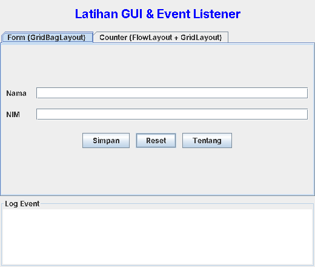
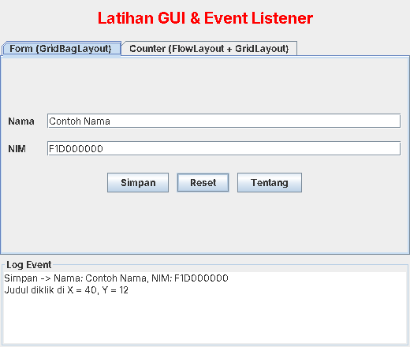
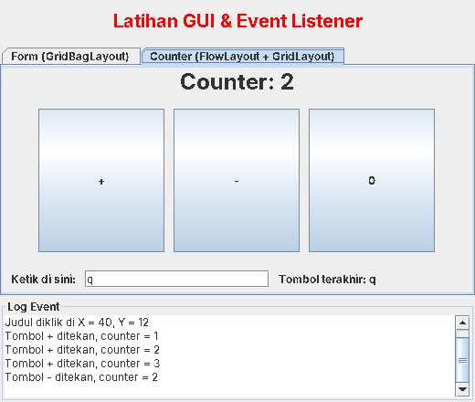

# Latihan/Eksplorasi GUI pada Java (Swing)

Tugas PBO Pertemuan 11: GUI dan Event Listener.

Program `GuiDemo.java` adalah satu aplikasi Swing yang mencoba semua komponen yang diminta: top-level container, intermediate container, atomic component, layout (4 jenis), dan event listener.

## Cara menjalankan

```bash
javac GuiDemo.java
java GuiDemo
```

## 5 Komponen Utama GUI yang Digunakan

**1. Top-Level Container: `JFrame` dan `JOptionPane`.** `JFrame` adalah jendela utama tempat semua komponen diletakkan. Layout manager tidak diset langsung pada frame, tetapi pada content pane-nya lewat `getContentPane().setLayout(...)`. `setDefaultCloseOperation(JFrame.DO_NOTHING_ON_CLOSE)` dipakai agar penutupan frame ditangani sendiri. `JOptionPane` dipakai untuk dialog (`showMessageDialog` dan `showConfirmDialog`).

**2. Intermediate Container: `JPanel`, `JTabbedPane`, dan `JScrollPane`.** `JPanel` mengelompokkan komponen (panel form, panel counter, dan baris tombol). `JTabbedPane` menampung dua panel dalam bentuk tab. `JScrollPane` membungkus `JTextArea` log agar bisa di-scroll.

**3. Atomic Component: `JLabel`, `JTextField`, `JButton`, dan `JTextArea`.** `JLabel` menampilkan teks (judul, label Nama/NIM, counter). `JTextField` menerima input (nama, NIM, teks ketikan). `JButton` adalah tombol aksi (Simpan, Reset, Tentang, +, -, 0). `JTextArea` menampilkan log event.

**4. Layout Manager: `BorderLayout`, `GridBagLayout`, `FlowLayout`, dan `GridLayout`.** `BorderLayout` mengatur frame utama (judul di NORTH, tab di CENTER, log di SOUTH). `GridBagLayout` mengatur form Nama/NIM dengan `GridBagConstraints` (gridx, gridy, gridwidth, fill, weightx, insets, anchor). `FlowLayout` mengatur baris tombol Simpan/Reset/Tentang dan baris input keyboard. `GridLayout` mengatur tiga tombol counter dengan ukuran sama.

**5. Event Listener:** `ActionListener`, `MouseAdapter`, `KeyAdapter`, dan `WindowAdapter`. Semua dibuat sebagai inner class dan didaftarkan dengan `addXListener(...)`.

| Listener / Adapter | Dipasang pada | Fungsi |
|---|---|---|
| `ActionListener` (`actionPerformed`) | tombol Simpan, Reset, Tentang, +, -, 0 dan textfield NIM (Enter) | menyimpan/mereset form, mengubah counter, menampilkan dialog |
| `MouseAdapter` (`mouseEntered`, `mouseExited`, `mouseClicked`) | label judul | warna judul berubah merah saat mouse masuk, kembali biru saat keluar, klik dicatat di log |
| `KeyAdapter` (`keyTyped`) | textfield "Ketik di sini" | menampilkan tombol terakhir yang diketik |
| `WindowAdapter` (`windowClosing`) | frame | dialog konfirmasi sebelum program ditutup |

## Screenshot

Tampilan awal (Form dengan `GridBagLayout`):



Setelah tombol Simpan ditekan dan judul diklik (log event terisi):



Tab Counter (`GridLayout` dan `FlowLayout`) setelah tombol +, -, dan input keyboard dicoba:


